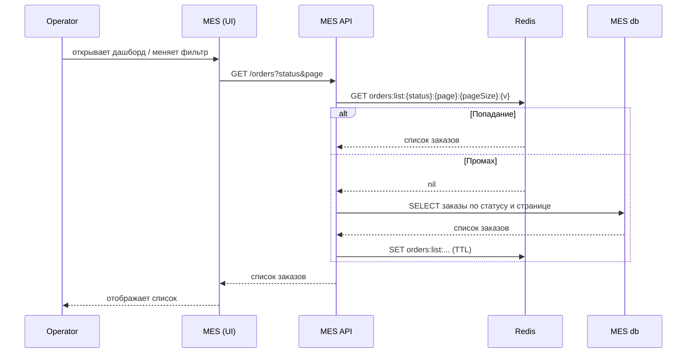
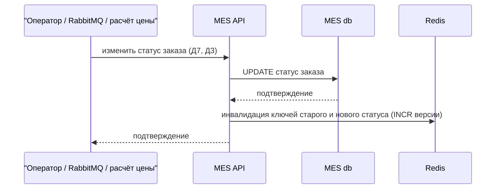
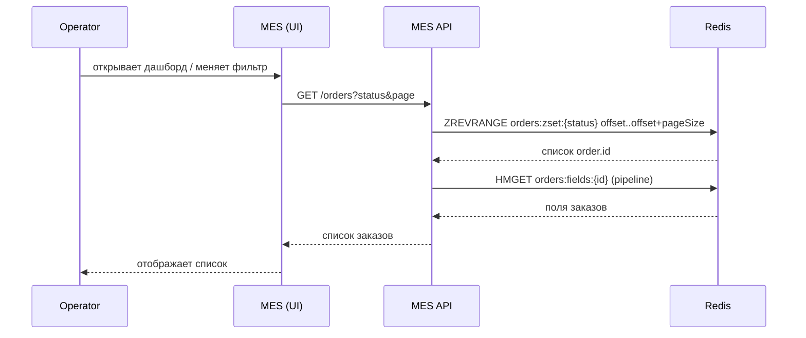
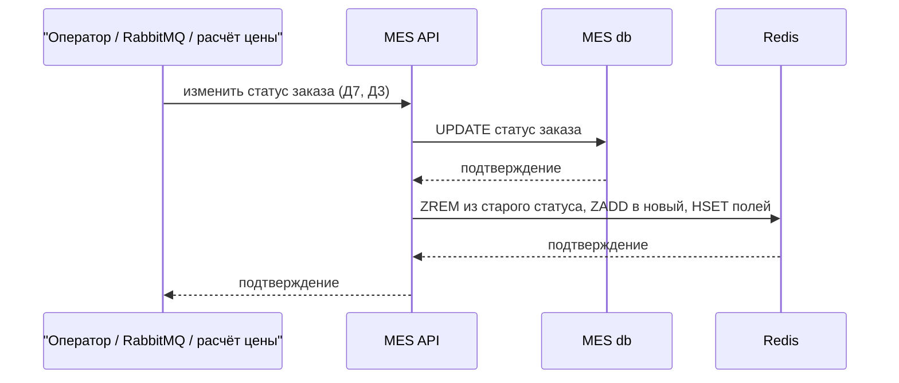

# «Архитектурное решение по кешированию»

Документ опирается на условие, [схему C4](../jewerly_c4_model.drawio) и допущения из [README](../README.md) (Д1–Д8).

## Анализ системы

Операторы жалуются на низкую скорость первой страницы MES. Метрики из [Task2](../Task2/Task2.md) (время ответа на запрос списка, загрузка MES API, подключения к MES db) покажут это количественно после внедрения, но причина видна уже по схеме и условию: MES API при каждом действии оператора читает список заказов из MES db напрямую, без кеша (Д8). Фильтр по статусам и пагинация это не исправили, потому что оба всё равно обращаются к базе на каждый запрос.

### Кандидаты на кеширование

| Кандидат                            | Кто читает                                                         | Кто пишет                                                                                         | Как часто меняется                                                       | Чем опасна неактуальность                                                                                                                   | Решение                                                                                                                                                                                              |
| ----------------------------------- | ------------------------------------------------------------------ | ------------------------------------------------------------------------------------------------- | ------------------------------------------------------------------------ | ------------------------------------------------------------------------------------------------------------------------------------------- | ---------------------------------------------------------------------------------------------------------------------------------------------------------------------------------------------------- |
| Список заказов дашборда MES         | Все операторы, одни и те же выборки по статусу, фильтру и странице | MES API: смена статуса от действий оператора, от сообщений RabbitMQ (Д7), после расчёта цены (Д3) | Часто и предсказуемо: один писатель, изменения идут через запись статуса | Высокая: кто первым увидел новый заказ, тот его берёт и получает оплату (условие). Устаревший список даёт операторам не совпадающую картину | **Кешируем.** Больная точка из условия, много читателей на одни и те же данные, один писатель — инвалидацию делать просто                                                                            |
| Карточка заказа по `order.id`       | Оператор открывает конкретный заказ                                | Тот же MES API                                                                                    | Так же часто, но на один заказ читает обычно один оператор в моменте     | Низкая: не влияет на то, кто первым возьмёт заказ                                                                                           | **Не кешируем.** В условии жалоб на карточку нет, читателей на одну запись мало, риск отдать неактуальные данные не оправдан выгодой                                                                 |
| Каталог интернет-магазина           | Покупатели, Shop API                                               | Редко, вручную                                                                                    | Низкая: ассортимент меняется не часто                                    | Низкая: устаревшая витрина не критична                                                                                                      | **Не кешируем.** Жалоб на магазин в условии нет, фокус задания — MES                                                                                                                                 |
| Результат расчёта цены по 3D-модели | MES API отдаёт цену в CRM (Д6)                                     | MES API, после расчёта (Д3)                                                                       | Раз на заказ                                                             | Низкая, но кеш здесь работал бы, только если модели повторяются                                                                             | **Не кешируем.** У нас нет данных о том, что модели повторяются между заказами (нет такого допущения). Кеш на неповторяющихся ключах бесполезен, а сам расчёт остаётся такой же нагрузкой на MES API |

### Почему список заказов — самое узкое место

- **Много читателей на одни и те же данные.** У остальных кандидатов чтение либо разовое (карточка заказа), либо редкое (каталог), либо не имеет смысла кешировать по содержанию (расчёт цены). У списка заказов одна и та же выборка читается повторно всеми операторами.
- **Единственный писатель.** В MES db пишет только MES API (по схеме). Три источника изменений — действия оператора, сообщения из RabbitMQ, результат расчёта цены — сходятся в одном компоненте, значит, инвалидацию можно делать в одном месте.
- **Ресурсы уже разделены.** MES API в одном экземпляре одновременно считает цены (до 30 минут, Д3), отдаёт список заказов и принимает запросы API-клиентов (Д6). Каждый лишний запрос к MES db на чтение списка отнимает ресурсы у расчёта, и наоборот.

### Паттерн доступа дашборда

- Запросы идут по параметрам: статус (или несколько), номер страницы, размер страницы. Сортировка «новые сверху» — операторам нужны самые новые заказы (условие).
- Число операторов, читающих список одновременно, в условии не указано. Дальше считаем это параметром `N`, а не числом.
- Личных представлений (например, «мои заказы») в условии нет: MES «показывает список заказов» и «назначает заказы на операторов», разделения по оператору в описании контейнера нет. Далее считаем список общим для всех операторов, а не персональным.

### Что входит в кеширование

- **Internet Shop, CRM, оба API магазина и CRM, Shop DB** — не участвуют, кешируем только контур MES.
- **MES** (React-интерфейс) — читает список через MES API, сам кеш не хранит.
- **MES API** — точка чтения и записи, здесь стоит логика кеша (чтение, запись, инвалидация).
- **Кеш (Redis)** — новый компонент, хранит списки заказов.
- **MES db** — источник данных при промахе кеша. Туда же MES API пишет новый статус, что и запускает инвалидацию в Redis.
- **Messages Queue (RabbitMQ)** — источник части изменений статуса (Д7), которые запускают инвалидацию в MES API.

## Мотивация

MES чувствует себя не очень хорошо с двух сторон сразу: операторы жалуются на низкую скорость страницы, а новых клиентов не устраивает скорость выполнения заказа. Кеширование списка заказов напрямую решает первую жалобу и косвенно облегчает вторую.

### Что происходит сейчас

- **Каждое действие оператора идёт в базу.** Открытие дашборда, смена фильтра, переход по страницам — всё это отдельные запросы через MES API в MES db (Д8). Кеша нет, поэтому одна и та же выборка пересчитывается заново для каждого оператора и каждого действия.
- **Фильтр и пагинация не помогли.** Команда уже пробовала их добавить (условие), но проблема осталась: оба всё равно читают из базы на каждый запрос, объём чтения из базы для одного запроса уменьшился, а число запросов — нет.
- **MES API поделен между тремя нагрузками.** Тот же единственный инстанс, что отдаёт список, ещё считает цену (до 30 минут) и принимает запросы API-клиентов (Д6, Д3). Каждый запрос списка отнимает ресурсы у расчёта, и наоборот: долгий расчёт может замедлить и без того медленный дашборд.
- **Задержка стоит денег напрямую.** Кто первым увидел новый заказ, тот его берёт и получает оплату (условие). Если дашборд показывает список с опозданием, вознаграждение получает не тот оператор, который взялся бы за заказ первым при свежих данных, — это не только раздражает, но и несправедливо распределяет оплату.

### Какую проблему решает кеширование

- **Напрямую:** медленный дашборд MES. Кеш убирает обращение к MES db на большинстве запросов списка, MES API отвечает из памяти кеша, а не ждёт базу.
- **Косвенно:** скорость выполнения заказа для клиентов. Кеширование не ускоряет сам расчёт цены (это отдельная задача, не входящая в это решение), но освобождает MES API от лишней нагрузки чтения, а значит, оставляет ему больше ресурсов на расчёт. Прямой связи «кеш списка → быстрее расчёт» нет, и мы не обещаем её как гарантированный эффект.

### Какие элементы системы входят в кеширование

Из раздела «Анализ системы»: MES (интерфейс), MES API (логика кеша), Redis (кеш), MES db (источник данных и место записи), Messages Queue (источник части инвалидаций). Кешируем только список заказов дашборда — самое узкое место сейчас. Карточка заказа, каталог магазина и результат расчёта цены в кеширование не входят, причины в таблице кандидатов.

### Как поймём, что кеширование помогло

Базовых значений сейчас нет, числа не задаём. Значения «до» берём из метрик [Task2](../Task2/Task2.md), которые фиксируем до выката кеша, «после» сравниваем через первые недели работы.

| Метрика                                                          | Источник                                                                 | Что показывает                                                                                                             |
| ---------------------------------------------------------------- | ------------------------------------------------------------------------ | -------------------------------------------------------------------------------------------------------------------------- |
| Время ответа на запрос списка заказов (медиана, 95-й процентиль) | [Task2](../Task2/Task2.md), метрика времени ответа MES API по `endpoint` | Главный эффект: должно заметно снизиться после внедрения кеша                                                              |
| CPU и число подключений MES API и MES db                         | [Task2](../Task2/Task2.md)                                               | Показывает, что чтение списка перестало нагружать базу и инстанс наравне с расчётом цены                                   |
| Доля попаданий кеша (hit rate)                                   | Новая метрика кеша, вводим в этом решении                                | Показывает, работает ли кеш как задумано. Низкая доля — сигнал пересмотреть ключи или TTL                                  |
| Число инвалидаций в минуту                                       | Новая метрика кеша                                                       | Проверяет, что инвалидация не происходит слишком часто (тогда кеш бесполезен) и не слишком редко (тогда данные устаревают) |
| Число жалоб операторов на устаревший или медленный список        | Обращения к тимлиду или продакт-менеджеру, как в Task2 и Task3           | Прямой бизнес-показатель, ради которого всё затевалось                                                                     |

Метрики кеша (доля попаданий, число инвалидаций) в план мониторинга [Task2](../Task2/Task2.md) не входили, добавляем их в этом документе и опишем в разделе «Внедрение и измерение эффекта».

## Предлагаемое решение

Схема решения: [jewerly_c4_caching.drawio](jewerly_c4_caching.drawio). Новый компонент (Redis) и новые связи выделены красным.

### Клиентское или серверное кеширование

|                                     | Клиентское (в браузере оператора)                                                                             | Серверное (в MES API)                                 |
| ----------------------------------- | ------------------------------------------------------------------------------------------------------------- | ----------------------------------------------------- |
| Эффект для всех операторов          | Каждый оператор кеширует у себя, N операторов — N обращений к базе на первый запрос каждого                   | Один кеш на всех, обращение к базе один раз на промах |
| Инвалидация при смене статуса       | Недостижима напрямую: обновление статуса из другого источника (RabbitMQ, расчёт цены, Д7) браузеру недоступно | MES API — точка записи, инвалидирует кеш сразу        |
| Снимает нагрузку с MES API и MES db | Частично, только для операторов, которые уже загружали список                                                 | Да, для всех                                          |

Берём серверное кеширование как основное. Клиентское добавляем только вспомогательно: MES API возвращает заголовок `ETag`, равный той же версии `v`, что и в ключе кеша (раздел «Дизайн кеша»), и интерфейс MES не перезагружает данные, если `ETag` не изменился. Это снимает повторную передачу неизменившегося списка по сети, но не запрос к MES API.

### Паттерн: Cache-Aside

|                                                                  | Cache-Aside                                                | Write-Through                                                                  | Refresh-Ahead                                                                           |
| ---------------------------------------------------------------- | ---------------------------------------------------------- | ------------------------------------------------------------------------------ | --------------------------------------------------------------------------------------- |
| Что при записи                                                   | Ничего в кеш, только инвалидация ключей                    | Пишет и в базу, и в кеш                                                        | Ничего, кеш обновляется по расписанию или на подходе к истечению TTL                    |
| Подходит ли для списков с разными параметрами (статус, страница) | Да: не переживает о выборках, которые никто не запрашивает | Нет: при записи одного заказа неясно, какие из N комбинаций фильтров обновлять | Нет: пришлось бы заранее знать, какие комбинации фильтров освежать                      |
| Риск устаревших данных                                           | Есть, закрывается инвалидацией при записи (ниже)           | Ниже, но ценой сложности выше                                                  | Есть между обновлениями, а расписание не поспевает за нерегулярными изменениями статуса |

Берём **Cache-Aside**: MES API при чтении сначала идёт в Redis, при промахе — в MES db и кладёт результат в кеш. При записи статуса кеш не трогает, только инвалидирует нужные ключи (раздел «Инвалидация»). Write-Through не подходит из-за комбинаторики ключей (статус × страница), Refresh-Ahead — потому что моменты изменения статуса (действие оператора, сообщение из очереди, расчёт цены) не подчиняются расписанию.

Задание ограничивает выбор этими тремя паттернами, но рядом с Cache-Aside часто рассматривают ещё и **Read-Through**: разница в том, кто грузит данные при промахе — в Cache-Aside это делает приложение, в Read-Through сам кеш через встроенный загрузчик. У Redis такого загрузчика нет, и его пришлось бы писать самим, то есть по сути повторить логику Cache-Aside в отдельном слое. А главную сложность — инвалидацию при записи статуса — Read-Through не убирает: она в любом случае остаётся в MES API. Поэтому лишний слой не оправдан, и в сравнение выше он не включён.

### Дизайн кеша

- **Ключ:** `orders:list:{status}:{page}:{pageSize}:{v}`, где `v` — версия для статуса, растёт при каждой инвалидации (раздел «Инвалидация»).
- **Значение:** список заказов страницы, как отдаёт API. Полей больше, чем нужно дашборду, не храним.
- **TTL:** короткая страховка (например, 30–60 секунд) на случай пропущенной инвалидации. Основной механизм свежести — не TTL, а инвалидация по записи.
- **Вытеснение:** `volatile-lru`, так как все ключи кеша снабжены TTL — вытесняются наименее используемые, а не случайные.
- **Размещение:** Redis на отдельном инстансе рядом с MES API, не в его памяти: перезапуск MES API не обнуляет кеш, и тот же кеш можно переиспользовать, если расчёт цены вынесут в отдельный процесс.

### Диаграммы последовательности

**Чтение списка заказов:**

**Изменение статуса заказа:**

### Инвалидация

| Стратегия                             | Подходит ли          | Почему                                                                                                                                                                                            |
| ------------------------------------- | -------------------- | ------------------------------------------------------------------------------------------------------------------------------------------------------------------------------------------------- |
| Временная (TTL)                       | Только как страховка | Заказ может провисеть в кеше до конца TTL с неверным статусом — риск для сценария «кто первый взял»                                                                                               |
| По ключу (удалить конкретный ключ)    | Нет как основная     | Список заказов кешируется во множестве комбинаций статус × страница, заранее неизвестно, какие ключи затронуты сменой статуса одного заказа                                                       |
| Программная, по версии (наше решение) | Да                   | При смене статуса заказа MES API инкрементирует версию `v` для старого и нового статуса. Все ключи с этой версией перестают запрашиваться сразу, без перебора конкретных страниц и без блокировок |

Берём **программную инвалидацию по версии**: при записи статуса MES API увеличивает счётчик версии для затронутых статусов, старые ключи кеша просто перестают использоваться и позже вытесняются по TTL. Короткий TTL остаётся страховкой на случай сбоя MES API между записью в базу и инвалидацией.

### Гонки и отказы

- **Redis недоступен:** MES API читает напрямую из MES db, дашборд работает медленнее, но не падает.
- **Промах у многих операторов одновременно:** одинаковый ключ, поэтому после первого промаха остальные читатели получают уже закешированный результат. Без блокировки чтения возможно несколько параллельных обращений к базе, но только в узком окне между первым промахом этой конкретной комбинации ключа и записью результата в кеш — и это не зависит от того, сколько всего операторов `N`, потому что после первой успешной записи в кеш все следующие читатели того же ключа получают его оттуда.
- **Запись между чтением базы и записью в кеш:** окно короткое, закрывается коротким TTL, если устаревшее значение всё же попало в кеш.

## Второй вариант и сравнение

Основное решение (Cache-Aside с инвалидацией по версии) — не единственный разумный вариант. Ниже второй, принципиально другой по конструкции, и сравнение между ними.

### Решение 1: Cache-Aside с инвалидацией по версии

Описано в разделе «Предлагаемое решение» выше: MES API кеширует ответ на конкретный запрос (статус, страница) при первом обращении, при записи статуса только увеличивает версию, старые ключи перестают использоваться. Диаграммы — там же.

### Решение 2: материализованный список (Write-Through)

Redis хранит не ответы на запросы, а сам список: отсортированное множество `orders:zset:{status}` (участники — `order.id`, вес — время последнего изменения статуса) и хеш `orders:fields:{orderId}` с полями для отображения. При записи статуса MES API обновляет Redis синхронно, в том же потоке, что и запись в MES db. Чтение любой страницы — это диапазон по отсортированному множеству, база не участвует.

**Чтение (любая страница, всегда из Redis):**

**Запись (смена статуса, синхронное обновление Redis):**

### Сравнение

|                      | Решение 1: Cache-Aside с версиями                                                                                                                                             | Решение 2: материализованный список                                                                                                                                                                                                                                                                                                                                       |
| -------------------- | ----------------------------------------------------------------------------------------------------------------------------------------------------------------------------- | ------------------------------------------------------------------------------------------------------------------------------------------------------------------------------------------------------------------------------------------------------------------------------------------------------------------------------------------------------------------------- |
| Описание и диаграмма | Кеш ответов по запросу, инвалидация версией ключа при записи. Диаграммы в разделе «Предлагаемое решение»                                                                      | Отсортированный список и поля в Redis, обновляются синхронно при записи. Диаграммы выше                                                                                                                                                                                                                                                                                   |
| Плюсы                | Кеш растёт только под реальные запросы, не под все заказы. Запись в MES API дешёвая — один инкремент версии. При недоступности Redis просто читаем базу, ничего не расходится | Данные в кеше актуальны сразу после записи, окна устаревания нет даже на TTL. Любая страница читается без обращения к MES db                                                                                                                                                                                                                                              |
| Минусы               | Короткое окно устаревания между записью и инвалидацией, закрыто TTL. Первый запрос после инвалидации — промах, идёт в базу                                                    | Redis хранит список всех активных заказов по каждому статусу целиком, память растёт с числом заказов, а не с популярностью запроса. Запись усложняется: DB и Redis обновляются в одном потоке, при сбое записи в Redis список расходится с базой, а восстанавливающего механизма в этом варианте нет. Фильтр сразу по нескольким статусам требует слияния нескольких ZSET |

### Заключение

Берём **Решение 1**. Оно проще на пути записи (один инкремент версии против согласованного обновления двух хранилищ) и безопаснее при сбоях: расхождение между MES db и Redis в нём невозможно, потому что Redis не хранит ничего, кроме результата чтения. Решение 2 даёт лучшую свежесть, но переносит на MES API риск, которого сейчас в системе и так хватает (Д5): рассинхронизацию источника и копии данных без механизма её обнаружения и починки. Заказов с каждым месяцем больше (условие), значит, память под материализованный список в Решении 2 будет расти вместе с ними, а не оставаться пропорциональной нагрузке чтения.

Если после внедрения Решения 1 короткое окно устаревания (TTL) всё ещё будет ощутимо для операторов, к Решению 2 можно вернуться не целиком, а частично: материализовать только первую страницу каждого статуса — самый частый запрос, — оставив Cache-Aside для остальных.

## Внедрение и измерение эффекта

### Метрики и алерты

Кеш встраиваем в тот же мониторинг, что и остальную систему ([Task2](../Task2/Task2.md)): экспортёр Redis отдаёт метрики в Prometheus, дашборд и алерты — в Grafana и Alertmanager, теми же уровнями и каналами.

| Метрика                               | Источник                               | Зачем                                                                                       |
| ------------------------------------- | -------------------------------------- | ------------------------------------------------------------------------------------------- |
| Доля попаданий (hit rate)             | Счётчики MES API при обращении к Redis | Показывает, работает ли кеш: устойчиво низкая доля — сигнал пересмотреть ключи или TTL      |
| Число инвалидаций в минуту            | MES API (инкременты версии)            | Слишком частая инвалидация обнуляет пользу кеша                                             |
| Память и число вытеснений (evictions) | Экспортёр Redis                        | Один инстанс кеша: вытеснения означают, что данные не помещаются, и попадания начнут падать |
| Время ответа на запрос списка заказов | Уже в [Task2](../Task2/Task2.md)       | Главный целевой эффект решения                                                              |

Алерты: устойчиво низкий hit rate (предупреждение), рост вытеснений (предупреждение), недоступность Redis (предупреждение, а не критично — MES API переходит на прямое чтение MES db и продолжает работать).

### Размещение

Redis — отдельный инстанс, не память MES API (обоснование в разделе «Дизайн кеша»). Вариант размещения — управляемый сервис Yandex Cloud (сейчас называется Managed Service for Valkey — совместимый форк, на который перешли после смены лицензии Redis), как и обе базы данных; альтернатива — свой инстанс EC2, если совместимость с Valkey не устроит. Выбор — задача внедрения, а не архитектурное решение этого документа.

### Задачи

| Задача                                                                                                             | Кто                              |
| ------------------------------------------------------------------------------------------------------------------ | -------------------------------- |
| Развернуть Redis (или совместимый сервис) в dev, задать лимит памяти и политику вытеснения                         | DevOps                           |
| Реализовать в MES API чтение и запись кеша списка (Cache-Aside) и инвалидацию по версии при смене статуса          | C#-разработчик                   |
| Добавить `ETag` в ответ списка и обработку в интерфейсе MES                                                        | C#-разработчик, фронтенд-инженер |
| Подключить экспортёр Redis, метрики, дашборд и алерты                                                              | DevOps                           |
| Проверить в release: hit rate на реальном профиле запросов, поведение при недоступности Redis, нагрузку на MES API | QA, DevOps                       |
| Выкатить в prod, через первые недели уточнить TTL и пороги алертов по факту                                        | DevOps, тимлид                   |

